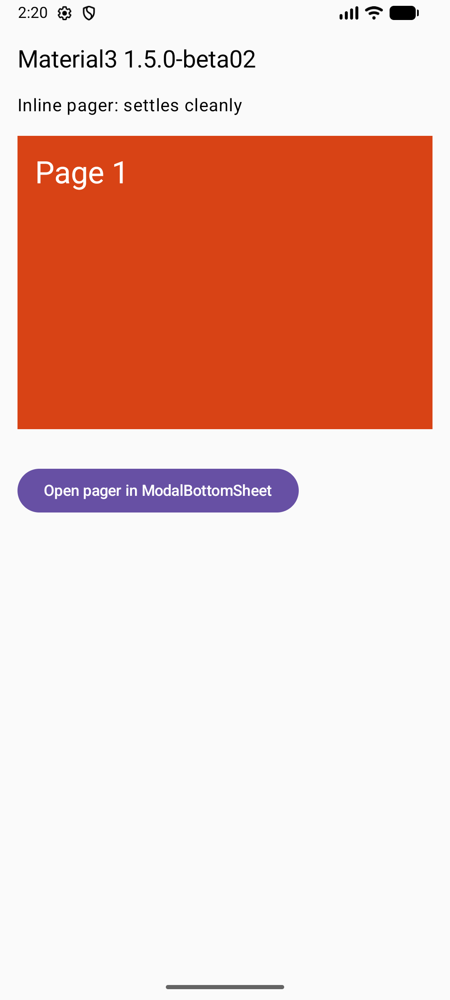
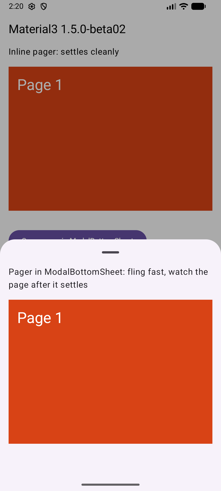

# Material3 `ModalBottomSheet` + `HorizontalPager`: the page overscrolls against the swipe after it settles

Minimal Jetpack Compose reproduction, no third-party libraries.

A `HorizontalPager` inside a Material3 `ModalBottomSheet` snaps to its page and then plays the
stretch overscroll in the **opposite** direction of the swipe and springs back. The same pager
outside the sheet settles cleanly.

- Affected: `androidx.compose.material3:material3` **1.5.0-alpha10 through 1.5.0-beta02** (newest at the time of writing).
- Not affected: **1.5.0-alpha09** and earlier, including **1.4.0** stable.
- Visible on Android 12 and newer, where overscroll is the stretch effect.
- Foundation is pinned to 1.12.1 in every build, so only Material3 changes.

## Run it

```sh
./gradlew installDebug                          # Material3 1.5.0-beta02 (default), reproduces
./gradlew installDebug -Pmaterial3=1.4.0        # last stable, does not reproduce
```

1. Fling the inline pager at the top. Each page eases into place.
2. Tap **Open pager in ModalBottomSheet** and fling between pages. A fast fling shows it best.
   After the page settles, it stretches against the swipe and springs back.

## Measure it

The pager's overscroll effect is wrapped so the velocity Foundation hands it after each fling is
logged. The stretch animates `velocity - performFling(velocity)`, so anything other than 0 after
the page settled is the overscroll that plays against the swipe.

```sh
adb logcat -s SheetPagerOverscroll:I
```

An instrumented test flings the pager four times inline and four times in the sheet with a
4,000 px/s end velocity and asserts nothing is left for overscroll:

```sh
./gradlew connectedDebugAndroidTest                      # fails on 1.5.0-beta02
./gradlew connectedDebugAndroidTest -Pmaterial3=1.4.0    # passes
```

Results on an Android 17 emulator (API 37). Velocity left for the pager's overscroll after each
4,000 px/s test fling, in px/s:

| Material3 | inline pager | pager in `ModalBottomSheet` | test |
| --- | --- | --- | --- |
| 1.4.0 | 0, 0, 0, 0 | 0, 0, 0, 0 | passes |
| 1.5.0-beta02 | 0, 0, 0, 0 | +4,000, -4,000, +4,000, -4,000 (always against the fling) | fails |

A manual fling in the sheet on 1.5.0-beta02 logs the same thing, with the pager's own consumption
counted twice: `fling.x=-17905 consumed.x=-35810 leftForOverscroll.x=17905`.

## Screenshots and recording

| Inline pager | Pager in the sheet |
| --- | --- |
|  |  |

[media/3-sheet-fling-beta02.mp4](media/3-sheet-fling-beta02.mp4): flings in the sheet on
1.5.0-beta02. After the first fling settles, the page stretches against the swipe and springs back.

## Root cause

`ConsumeSwipeWithinBottomSheetBoundsNestedScrollConnection` in `SheetDefaults.kt` wraps the sheet
content. Since 1.5.0-alpha10 its `onPostFling` is:

```kotlin
override suspend fun onPostFling(consumed: Velocity, available: Velocity): Velocity {
    val toFling = available.toFloat()
    val consumedByAnchoredDraggableFling = sheetState.anchoredDrag(flingBehavior, toFling)
    return Velocity(consumed.x, consumedByAnchoredDraggableFling)
}
```

`onPostFling` must return the velocity **this connection** consumed. For a vertical sheet it returns
`consumed.x`, the horizontal velocity the child already consumed, as if the sheet consumed it too.

Foundation's `ScrollingLogic` then computes what is left for overscroll:

```kotlin
val velocityLeft = doFlingAnimation(available)
val consumedPost = nestedScrollDispatcher.dispatchPostFling(available - velocityLeft, velocityLeft)
val totalLeft = velocityLeft - consumedPost
// performFling returns velocity - totalLeft; overscroll animates velocity - that
```

The pager consumes its whole fling while snapping, so `velocityLeft.x` is about 0 and
`consumedPost.x` is about `available.x`. That makes `totalLeft.x` about `-available.x`: the
overscroll effect receives the fling velocity, reversed. Before 1.5.0-alpha10 the method returned
`available`, which has no horizontal component here.

## Fix

Report only what the sheet consumed, on the sheet's axis:

```kotlin
return if (orientation == Orientation.Horizontal) {
    Velocity(consumedByAnchoredDraggableFling, 0f)
} else {
    Velocity(0f, consumedByAnchoredDraggableFling)
}
```

## Environment

- Android emulator, Pixel-class profile, API 37, arm64.
- AGP 9.1.1, Kotlin 2.2.0, Gradle 9.3.1, compileSdk 37, Foundation 1.12.1.
